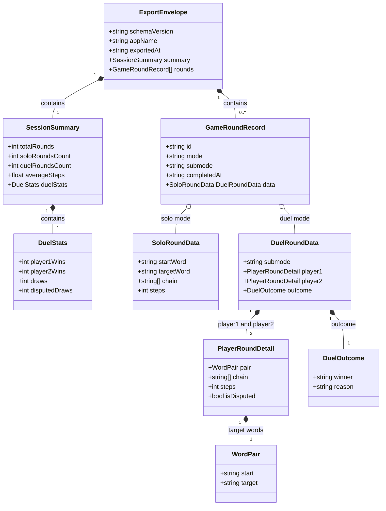
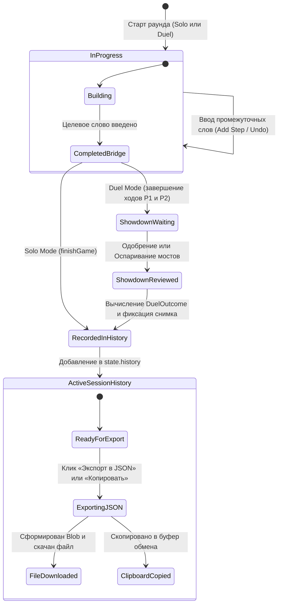

# Data Model: Логика и структуры данных для экспорта истории игры в JSON

**Feature**: `001-export-game-history` | **Date**: 2026-10-22

Документ описывает структуры данных, их связи, правила валидации и жизненный цикл сущностей для экспорта истории игры WordBridge.

---

## 1. Сущности и диаграмма связей

---

## 2. Спецификация полей сущностей

### 2.1. `ExportEnvelope` (Корневой контейнер экспорта)
* **`schemaVersion`** (`string`, обязательное): Версия формата экспорта. Фиксированное значение `"1.0.0"`.
* **`appName`** (`string`, обязательное): Название приложения. Фиксированное значение `"WordBridge"`.
* **`exportedAt`** (`string`, обязательное): Метка времени формирования экспорта в формате ISO 8601 (например, `"2026-10-22T20:30:00.000Z"`).
* **`summary`** (`SessionSummary`, обязательное): Сводная статистика по всем включенным раундам.
* **`rounds`** (`GameRoundRecord[]`, обязательное): Массив записей раундов в хронологическом порядке их завершения.

### 2.2. `SessionSummary` (Агрегированная сводка сессии)
* **`totalRounds`** (`integer >= 0`, обязательное): Общее количество завершённых раундов (`rounds.length`).
* **`soloRoundsCount`** (`integer >= 0`, обязательное): Количество раундов в режиме `"solo"`.
* **`duelRoundsCount`** (`integer >= 0`, обязательное): Количество раундов в режиме `"duel"`.
* **`averageSteps`** (`number >= 0`, обязательное): Среднее число шагов (округление до 1 знака после запятой) по всем валидным цепочкам.
* **`duelStats`** (`DuelStats`, обязательное):
  * **`player1Wins`** (`integer >= 0`): Победы Игрока 1.
  * **`player2Wins`** (`integer >= 0`): Победы Игрока 2.
  * **`draws`** (`integer >= 0`): Обычные ничьи (равное количество шагов).
  * **`disputedDraws`** (`integer >= 0`): Взаимные оспаривания.

### 2.3. `GameRoundRecord` (Запись раунда)
* **`id`** (`string`, обязательное): Уникальный идентификатор раунда формата `"round-<timestamp>-<random4>"` или `"round-<index>"`.
* **`mode`** (`string`, обязательное): Допустимые значения: `"solo"`, `"duel"`.
* **`submode`** (`string | null`, обязательное): Допустимые значения: `"race"`, `"challenge"`, либо `null` для соло.
* **`completedAt`** (`string`, обязательное): Дата и время завершения раунда по стандарту ISO 8601.
* **`data`** (`SoloRoundData | DuelRoundData`, обязательное): Детальные данные раунда.

### 2.4. `SoloRoundData` (Данные соло-раунда)
* **`startWord`** (`string`, обязательное, не пустое): Стартовое слово.
* **`targetWord`** (`string`, обязательное, не пустое): Целевое слово.
* **`chain`** (`string[]`, обязательное, длина >= 2): Последовательность слов моста от `startWord` до `targetWord`.
* **`steps`** (`integer >= 1`, обязательное): Количество добавленных промежуточных шагов (`chain.length - 1`).

### 2.5. `DuelRoundData` (Данные раунда дуэли)
* **`submode`** (`string`, обязательное): `"race"` (одна общая пара слов) или `"challenge"` (взаимно загаданные пары).
* **`player1`** (`PlayerRoundDetail`, обязательное): Данные игры Игрока 1.
* **`player2`** (`PlayerRoundDetail`, обязательное): Данные игры Игрока 2.
* **`outcome`** (`DuelOutcome`, обязательное): Итог дуэли.

### 2.6. `PlayerRoundDetail`
* **`pair`** (`WordPair`, обязательное): `{ "start": string, "target": string }`.
* **`chain`** (`string[]`, обязательное, длина >= 2): Цепочка слов игрока.
* **`steps`** (`integer >= 1`, обязательное): Число шагов игрока (`chain.length - 1`).
* **`isDisputed`** (`boolean`, обязательное): Был ли мост оспорен соперником на этапе Showdown.

### 2.7. `DuelOutcome`
* **`winner`** (`string`, обязательное): Допустимые значения: `"player1"`, `"player2"`, `"draw"`, `"disputed_draw"`.
* **`reason`** (`string`, обязательное): Текстовое описание исхода партии (например: `"Игрок 1 построил более короткий мост (3 против 5 шагов)!"`).

---

## 3. Правила валидации и инварианты целостности данных

1. **Инвариант цепочки (Chain Boundary)**:
   - Для соло: `chain[0] == startWord` и `chain[chain.length - 1] == targetWord`.
   - Для каждого игрока в дуэли: `chain[0] == pair.start` и `chain[chain.length - 1] == pair.target`.
2. **Инвариант шагов (Steps Consistency)**:
   - Значение `steps` строго равно `chain.length - 1`.
   - Для любого завершённого раунда `steps >= 1`.
3. **Инвариант исхода дуэли (Outcome Mapping)**:
   - Если `player1.isDisputed && player2.isDisputed` → `winner == "disputed_draw"`.
   - Если `player1.isDisputed && !player2.isDisputed` → `winner == "player2"`.
   - Если `!player1.isDisputed && player2.isDisputed` → `winner == "player1"`.
   - Если `!player1.isDisputed && !player2.isDisputed`:
     - `player1.steps < player2.steps` → `winner == "player1"`.
     - `player2.steps < player1.steps` → `winner == "player2"`.
     - `player1.steps == player2.steps` → `winner == "draw"`.
4. **Инвариант полноты данных**:
   - Ни одно свойство не должно принимать значение `undefined` или `NaN`.
   - Строковые значения слов триммируются от случайных пробелов.

---

## 4. Жизненный цикл раунда и фиксация в истории

