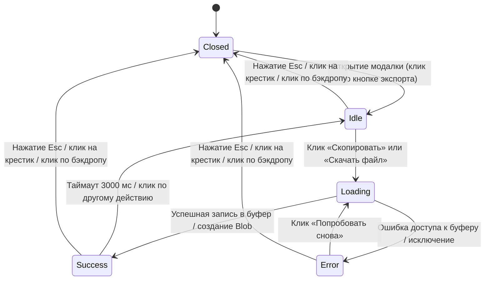

# Phase 1: Data Model — UI экспорта результатов игры

**Feature**: `001-export-game-results-ui`  
**Date**: 2026-10-22  
**Status**: APPROVED  

---

## 1. Сущность состояния модального окна (`ExportModalState`)

Описывает внутреннее динамическое состояние пользовательского интерфейса модального окна экспорта в `src/app.js`.

```typescript
interface ExportModalState {
  /** Флаг видимости модального окна */
  isOpen: boolean;

  /** Текущая фаза жизненного цикла операции */
  phase: "idle" | "loading" | "success" | "error";

  /** Текущий тип выполняемого действия */
  actionType: "copy" | "download" | null;

  /** Человекочитаемый текст сообщения для блока статуса */
  statusMessage: string;

  /** Идентификатор активного таймера для авто-сброса успешного статуса (3000 мс) */
  resetTimerId: number | null;

  /** Ссылка на элемент DOM, с которого было вызвано открытие модалки (для возврата фокуса) */
  previousActiveElement: HTMLElement | null;

  /** Подготовленные данные текущего матча */
  currentSummary: MatchSummaryPayload | null;

  /** Подготовленный текстовый отчёт для предпросмотра и копирования */
  shareableText: string;
}
```

### Правила валидации и инварианты:
- Если `phase === "loading"`, интерактивные кнопки действий (`#export-copy-btn`, `#export-download-btn`) ОБЯЗАНЫ иметь свойство `disabled = true`.
- При вызове `closeExportModal()` любой активный `resetTimerId` ОБЯЗАН очищаться через `clearTimeout(resetTimerId)`.
- При открытии модалки `phase` ВСЕГДА сбрасывается в `"idle"`, а `statusMessage` — в `"Выберите действие для экспорта"`.

---

## 2. Диаграмма переходов состояний модального окна (State Transitions)



---

## 3. Сущность данных завершенного матча (`MatchSummaryPayload`)

Соответствует утвержденному в `specs/contract.md` контракту между `001-export-game-results-ui` и `001-export-game-history`:

```typescript
interface MatchSummaryPayload {
  schemaVersion: "1.0.0";
  mode: "solo" | "duel";
  submode: "race" | "challenge" | null;
  completedAt: string; // ISO 8601 строка
  pair: {
    start: string;
    target: string;
  };
  solo?: {
    chain: string[];
    steps: number;
  };
  duel?: {
    player1: {
      name: string;
      pair: { start: string; target: string };
      chain: string[];
      steps: number;
      isDisputed: boolean;
    };
    player2: {
      name: string;
      pair: { start: string; target: string };
      chain: string[];
      steps: number;
      isDisputed: boolean;
    };
    outcome: {
      winner: "player1" | "player2" | "draw" | "disputed_draw";
      winnerName: string;
      reason: string;
    };
  };
}
```

---

## 4. Сущность DOM-элементов модального окна (`ExportUIElements`)

Реестр ссылок на элементы интерфейса в DOM для чистого кэширования в объекте `elements` в `src/app.js`:

```typescript
interface ExportUIElements {
  /** Кнопка открытия на экране Showdown */
  showdownExportBtn: HTMLButtonElement;
  /** Оверлей модального окна */
  exportModal: HTMLElement;
  /** Кнопка закрытия модалки (крестик) */
  exportModalCloseBtn: HTMLButtonElement;
  /** Текстовое поле предпросмотра отчета */
  exportPreviewText: HTMLTextAreaElement | HTMLElement;
  /** Кнопка копирования в буфер обмена */
  exportCopyBtn: HTMLButtonElement;
  /** Кнопка скачивания JSON-файла */
  exportDownloadBtn: HTMLButtonElement;
  /** Контейнер статуса */
  exportStatusBadge: HTMLElement;
  /** Иконка статуса */
  exportStatusIcon: HTMLElement;
  /** Текст статуса */
  exportStatusText: HTMLElement;
  /** Кнопка повторной попытки (в состоянии ошибки) */
  exportRetryBtn: HTMLButtonElement;
}
```
